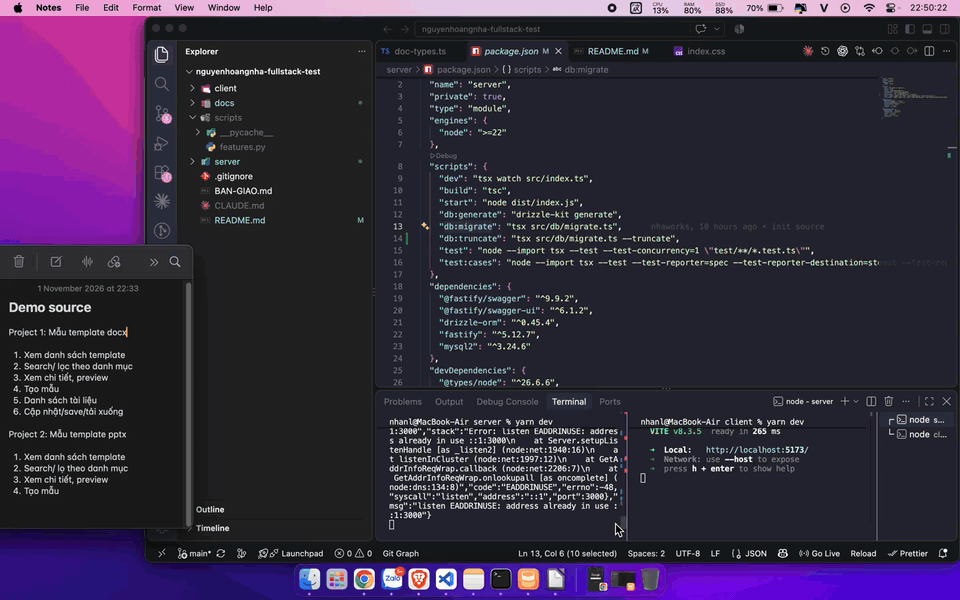
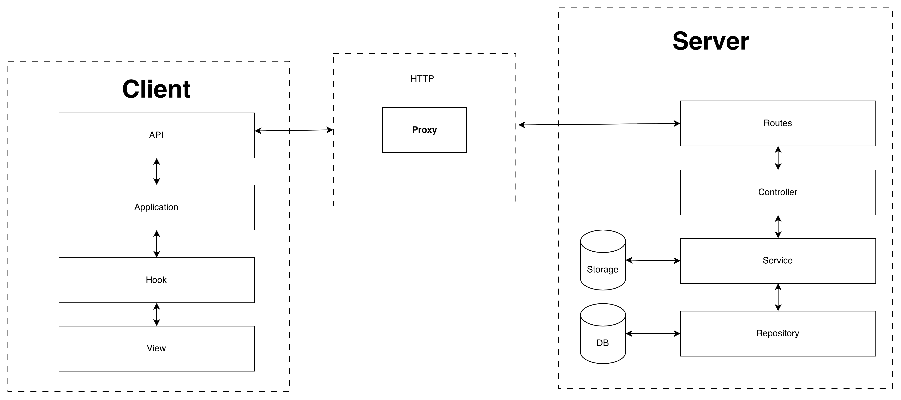
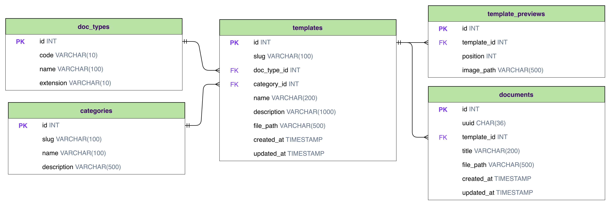

# Thư viện mẫu tài liệu

Hai sản phẩm dùng chung một backend và một frontend:

- **Bài 1 – Văn bản**: thư viện mẫu DOCX → tìm, lọc, xem trước → tạo tài liệu → sửa trong editor tích hợp → lưu / tải .docx.
- **Bài 2 – Trình chiếu**: thư viện bộ mẫu PPTX → tìm, lọc, xem từng slide → tạo bản sao độc lập → tải .pptx.

Danh mục bàn giao: [BAN-GIAO.md](BAN-GIAO.md).

## Video demo

 [docs/demo-recording.mp4](docs/demo-recording.mp4)

## Công nghệ

| Phần | Công nghệ |
|---|---|
| Backend (`server/`, port 3000) | Node.js 22, Fastify 5, TypeScript, Drizzle ORM, MySQL 8 |
| Frontend (`client/`, port 5173) | React 19, Vite, TypeScript, Tailwind CSS 4, axios |
| Editor DOCX | `@docx-editor.dev/react` |

## Kiến trúc



Backend chia module theo nghiệp vụ `templates`, `categories`, `documents`, 

```
Routes ──► Controller ──► Service ──► Repository ──► MySQL
```

Frontend chia module `templates`, `documents`, 

```
pages / components ──► hooks ──► application ──► api ──► /api (Vite proxy)
```

```
nguyenhoangnha-fullstack-test/
├── server/
│   ├── src/
│   │   ├── modules/
│   │   │   ├── templates/
│   │   │   ├── categories/
│   │   │   └── documents/
│   │   ├── db/
│   │   ├── app.ts
│   │   ├── config.ts
│   │   ├── openapi.ts
│   │   ├── response.ts
│   │   └── storage.ts
│   ├── drizzle/
│   ├── storage/
│   │   ├── templates/
│   │   └── previews/
│   └── test/
├── client/
│   └── src/
│       ├── app/
│       ├── modules/
│       │   ├── templates/
│       │   └── documents/
│       └── shared/
└── docs/
    ├── architecture.png
    ├── erd.png
    ├── features.xlsx
    ├── test-cases.csv
    └── test-cases-result.csv
```

### ERD



## Hướng dẫn cài đặt & start
Yêu cầu:
**Node.js 22+**, **MySQL 8.0+**

**Terminal 1 – Backend**

```bash
cd server
cp .env.example .env
npm install
npm run db:migrate
npm run dev
```

**Terminal 2 – Frontend**

```bash
cd client
cp .env.example .env
npm install
npm run dev
```

Mở http://localhost:5173

### Cấu hình

| Biến | Mặc định |
|---|---|
| `DB_HOST` · `DB_PORT` | `127.0.0.1` · `3306` |
| `DB_USER` · `DB_PASSWORD` | `root` · "" |
| `DB_NAME` · `TEST_DB_NAME` | `template_library` · `template_library_test` |
| `PORT` | `3000` |
| `STORAGE_ROOT` | `server/storage` |
| `DEFAULT_USER_ID` | `demo` |

## API và dữ liệu

- Swagger UI: http://localhost:3000/api/docs (hoặc http://localhost:5173/api/docs)


## Lưu trữ và tạo bản sao

Tất cả file được lưu trong thư mục `server/storage/`. Database chỉ lưu đường dẫn đến file, không lưu trực tiếp nội dung file.

### 1. Cách lưu file

- **File mẫu:** Lưu tại `storage/templates/`. Đây là các file gốc, hệ thống chỉ đọc và không chỉnh sửa.
- **Tài liệu người dùng:** Khi tạo tài liệu mới, hệ thống sao chép file mẫu thành một file riêng tại `storage/documents/demo/`, với tên file là UUID để tránh trùng lặp.
- **Lưu an toàn:** Hệ thống kiểm tra đường dẫn để đảm bảo file không thể truy cập hoặc ghi ra ngoài thư mục được phép.

### 2. Tạo và chỉnh sửa tài liệu

- **Tạo tài liệu:** File mẫu được sao chép thành tài liệu mới và lưu thông tin vào database trong cùng một transaction. Nếu xảy ra lỗi, file được tạo dở sẽ bị xóa.
- **Chỉnh sửa DOCX:** Frontend gửi toàn bộ file `.docx` sau khi chỉnh sửa lên server. Server kiểm tra định dạng, ghi vào file tạm rồi đổi tên thành file chính thức khi hoàn tất.

### 3. Thêm mẫu tài liệu mới

Để thêm một mẫu DOCX hoặc PPTX, thực hiện các bước sau:

1. Chép file mẫu vào `storage/templates/docx/` hoặc `storage/templates/pptx/`.
2. Thêm ảnh xem trước của tài liệu vào `storage/previews/<id>/`, đặt tên lần lượt là `1.png`, `2.png`, ...
3. Thêm thông tin mẫu vào `storage/templates/manifest.json`.
4. Khởi động lại server để hệ thống tải danh sách mẫu mới.

**Lưu ý:** Không cần sửa code frontend khi thêm mẫu mới. File mẫu gốc luôn được giữ nguyên; mỗi tài liệu được tạo sẽ có một bản sao riêng.

## Kiểm thử

```bash
cd server
npm test
npm run test:cases
```

`npm test` chạy toàn bộ test trên database `template_library_test`. `npm run test:cases` chạy 44 test case chức năng trong `docs/test-cases.csv` ghi kết quả ra `docs/test-cases-result.csv`.

## Trạng thái

Chi tiết từng tính năng: [docs/features.xlsx](docs/features.xlsx).

**Đã hoàn thành**: toàn bộ chức năng của hai sản phẩm theo yêu cầu của bài test

**Chưa hoàn thành**:
- Chưa có editor chỉnh sửa slide PPTX trong ứng dụng
- Chưa có đăng nhập jwt token, chưa xoá tài liệu, và danh sách tài liệu chưa phân trang.
- Chưa thực hiện reload lại ảnh preview khi sửa docx

**Giới hạn kỹ thuật**:
- Editor DOCX chưa test được các loại file phiên bản cũ
- Ảnh xem trước được tạo sẵn cùng bộ mẫu, không tự sinh khi thêm mẫu mới.
- Chưa có phân quyền: mọi tài liệu thuộc user `demo`

**Hướng mở rộng**: 
- Thêm phân quyền và xác thực user
- Thêm tự động cập nhật preview ảnh thumbnail
- Bổ sung phân trang nếu dữ liệu quá nhiều
- Mở rộng tích hợp ONLYOFFICE Docs hoặc Collabora để sửa PPTX / DOCX đầy đủ ngay trong trình duyệt

## Thư viện bên thứ ba

| Thư viện | Dùng cho | Giấy phép |
|---|---|---|
| @docx-editor.dev/react 2.33 | Editor DOCX  | Apache-2.0 |

## Ghi chú

Dự án có dùng AI (Claude Code) hỗ trợ:

| Hạng mục | Nội dung |
|---|---|
| Viết test case | Bộ test case chức năng `docs/test-cases.csv` |
| Sinh mã test case | Autotest `server/test/testcases.test.ts` và reporter ghi kết quả |
| Sinh tài liệu | README, BAN-GIAO.md, features.xlsx, bộ mẫu DOCX / PPTX |
| Hỗ trợ sinh mã code | Một phần mã backend và frontend |
|
| Sinh seeder | `server/src/db/seed.ts` nạp loại tài liệu, danh mục, mẫu và ảnh xem trước từ `manifest.json` |
